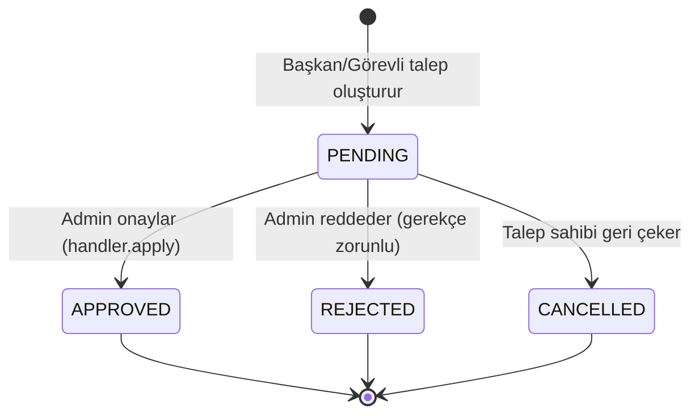

# Onay Motoru ve Ticket Sistemi

## 1. Neden genel bir motor?
Kulüp bilgisi, etkinlik yayını/düzenlemesi/iptali, üye çıkarma/engelleme, görevli atama/çıkarma, mezun doğrulama ve seçim sonucu **aynı yaşam döngüsünü** paylaşır: *talep → Admin kuyruğu → onay/ret → uygulama → bildirim*. Her biri için ayrı tablo/ekran yerine tek `ChangeRequest` tablosu + tip başına küçük handler kullanılır. ([ADR-0007](adr/0007-onay-motoru.md))

## 2. Yaşam döngüsü


## 3. Handler sözleşmesi (`src/modules/approval/domain/` + `handlers/`)
```ts
interface ApprovalHandler<P> {
  type: ChangeRequestType
  payloadSchema: z.ZodType<P>                  // oluştururken ve uygularken doğrulanır
  validateCreate(ctx, payload): Promise<void>  // ör. ekip 10'u aşıyor mu, aynı hedefe bekleyen talep var mı
  apply(tx, request, payload): Promise<void>   // onayda, transaction içinde
  onReject?(tx, request): Promise<void>        // ör. Event PENDING → DRAFT
  describe(payload, locale): DiffView          // Admin ekranında eski ↔ yeni gösterimi
}
```
Kayıt: `handlers/index.ts` içinde `type → handler` haritası. Modül sınırı: handler, ilgili modülün **public servis fonksiyonunu** çağırır (`club.applyClubUpdate(tx, ...)`).

## 4. Talep tipleri
| Tip | Talep eden | Payload | Ek / gerekçe | Onayda | Retta |
|---|---|---|---|---|---|
| `CLUB_UPDATE` | Başkan | `{before, after}` (ad hariç: açıklama, kısa açıklama, logo, kapak, iletişim, sosyal) | gerekçe opsiyonel | alanlar güncellenir, çeviri yenilenir | — |
| `EVENT_PUBLISH` | Başkan / `EVENT_MANAGE` | `{eventId}` (içerik etkinlikte) | — | `PUBLISHED`, DeepL çevirisi, feed cache temizlenir | `DRAFT` + Admin notu |
| `EVENT_UPDATE` | aynı | `{eventId, before, after}` (değişen alanlar) | gerekçe opsiyonel | alanlar uygulanır, başvuranlara "etkinlik güncellendi" bildirimi (tarih/konum değiştiyse) | yayındaki hali aynen kalır |
| `EVENT_CANCEL` | Başkan | `{eventId}` | gerekçe zorunlu | `CANCELLED`, başvuranlara bildirim | — |
| `MEMBER_REMOVE` | Başkan | `{userId}` | **gerekçe + kanıt zorunlu** | `Membership.status=REMOVED` | — |
| `MEMBER_BAN` | Başkan | `{userId, until?}` | **gerekçe + kanıt zorunlu** | `BANNED` (tekrar katılamaz) | — |
| `STAFF_ASSIGN` | Başkan | `{userId, title, permissions[]}` | — | `StaffAssignment` oluşur | — |
| `STAFF_REMOVE` | Başkan | `{userId}` | gerekçe opsiyonel | silinir | — |
| `ALUMNI_VERIFY` | Kullanıcı | `{}` | belge zorunlu | `User.status=ACTIVE`, `type=ALUMNI` | kullanıcı yeniden yükleyebilir |
| `ELECTION_RESULT` | Sistem | `{electionId, winnerUserId}` | — | `Club.presidentId` değişir, eski başkanın görevli ekibi korunur/sıfırlanır (Admin seçer) | — |

Kurallar:
- Aynı hedef + aynı tip için aynı anda **tek PENDING** talep (yeni talep eskisini günceller).
- Görevli yetki/unvanını değiştirmek = `STAFF_ASSIGN` (güncelleme).
- `EVENT_UPDATE` sırasında yayındaki içerik değişmez; taslak değişiklikler `payload.after`'da tutulur.
- Etkinlik düzenleme ekranı küçük düzeltmeleri de onaya gönderir (kullanıcı kararı). Talep kuyruğunu şişirmemek için Admin ekranında **fark görünümü** sadece değişen alanları gösterir.
- Onay/ret idempotent: `UPDATE ... WHERE status='PENDING'` etkilenen satır 0 ise "zaten karar verilmiş".
- Admin aynı işlemleri doğrudan yapabilir (talepsiz) — yine AuditLog'a yazılır.

## 5. Kanıt / ekler
- Tipler: PDF, JPG, PNG, WEBP; tek dosya ≤ 10 MB, talep başına ≤ 5 dosya.
- Private depolama; görüntüleme 5 dk geçerli imzalı URL (yalnızca talep sahibi kulübün Başkanı + üniversite Adminleri).
- MIME, dosya imzası (magic bytes) ile doğrulanır; dosya adı sanitize edilir; storage key rastgele.

## 6. Admin onay ekranı
- Kuyruk: filtre (tip, kulüp, tarih), en eski önce, sayaç rozeti header'da.
- Detay: talep eden, kulüp, gerekçe, ekler, **eski ↔ yeni fark** (metin farkı, görsel önce/sonra), "Onayla" / "Reddet (gerekçe zorunlu)".
- Etkinlik önizlemesi: etkinliğin yayında nasıl görüneceğini TR ve EN (çeviri onay anında yapılacağı için önizlemede "otomatik çevrilecek" notu) gösterir.
- Toplu işlem yok (bilinçli: her karar tek tek).

## 7. Ticket sistemi
| Alan | Değer |
|---|---|
| Kapsam | `CLUB_TO_ADMIN` (Başkan / `TICKET_OPEN` görevli → kendi üniversitesinin Adminleri), `ADMIN_TO_PLATFORM` (Admin → Süper Admin) |
| Durum | `OPEN` → (karşı taraf yanıtlayınca) `ANSWERED` → (talep eden yazınca) `OPEN` … → `CLOSED` (her iki taraf kapatabilir; kapalı ticket 7 gün içinde yeniden açılabilir) |
| Konu kategorileri | Etkinlik, Onay talebi, Üyelik, Turnuva, Teknik sorun, Diğer |
| İlişki | Opsiyonel `changeRequestId` / `eventId` bağlantısı ("bu talebim neden reddedildi?") |
| Ekler | Onay ekleriyle aynı kurallar |
| Bildirim | Yeni mesajda karşı tarafa uygulama içi + mail |
| Ekran | Liste (durum filtresi) + mesaj akışı (sohbet görünümü, gerçek zamanlı değil; gönderimde yenilenir) |
