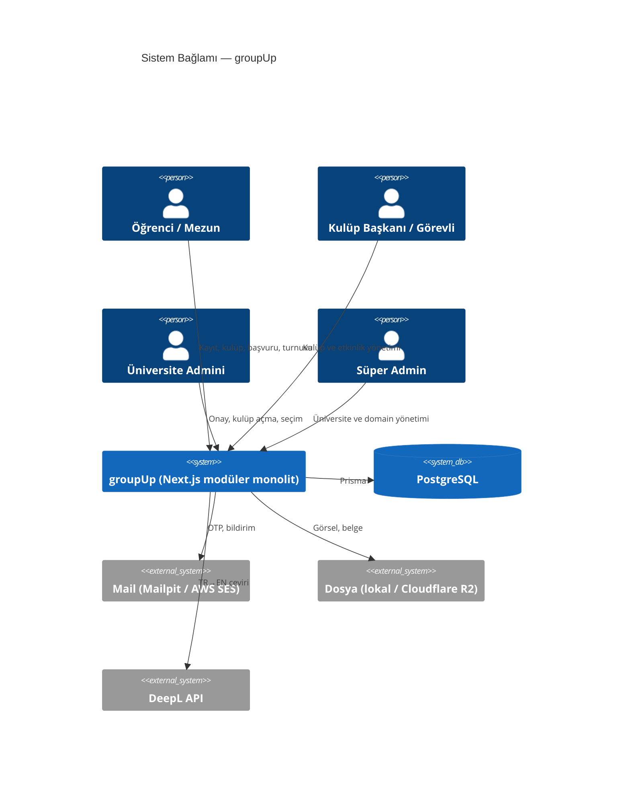
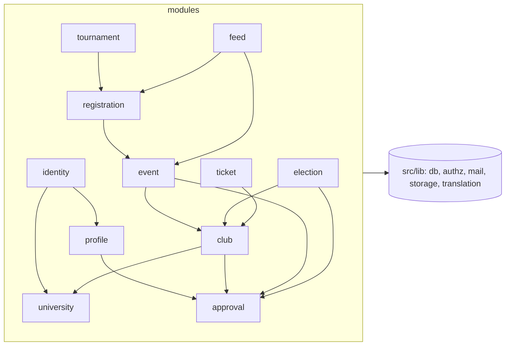

# Mimari Plan — groupUp

## 1. Özet
groupUp, **tek bir Next.js 16 uygulaması olarak modüler monolit** şeklinde inşa edilir. İş yetenekleri `src/modules/` altında sınırları lint ile korunan modüllere ayrılır. Veri PostgreSQL'de (Prisma 7). Dış servisler (mail, dosya, çeviri) küçük provider arayüzlerinin arkasındadır; lokal geliştirmede ücretsiz yerel karşılıkları kullanılır. Redis, kuyruk ve mikroservis yoktur. Gerekçe: tek geliştirici, tek web istemcisi, orta trafik ve öncelikli kalite niteliklerinin **maliyet, geliştirme hızı ve bakım kolaylığı** olması.

## 2. Gereksinimler (12 boyut)
| Boyut | Değer | Kaynak |
|---|---|---|
| Amaç | Kulüp etkinlik/başvuru/turnuva yönetimini tek yerde toplamak | Kullanıcı |
| Proje türü | Çok kiracılı (üniversite = tenant) web uygulaması, sonra mobil | Kullanıcı |
| Kullanıcı sayısı | İlk aşamada 1 üniversite, birkaç bin öğrenci; hedef birkaç üniversite | Varsayım |
| Trafik | Ortalama < 5 RPS, tepe (başvuru açılışı) ~50 RPS | Varsayım |
| Veri | İlişkisel, yazma/okuma ≈ 1/20, görseller ve belgeler büyüyebilir | Kullanıcı + varsayım |
| Takım | 1 geliştirici + Claude | Kullanıcı |
| Büyüme | Yeni üniversiteler, mobil uygulama | Kullanıcı |
| Bakım | Tek kişi → basit, standart yapı şart | Varsayım |
| Deploy | Şimdi lokal; sonra Vercel + yönetilen Postgres | Kullanıcı |
| Güvenlik | KVKK (kişisel veri), tenant izolasyonu, gizli oy | Analiz |
| Teknoloji | npm, Prisma, PostgreSQL (zorunlu); Next.js/Tailwind/zod bilinen | Kullanıcı + randevum-plus |
| Bütçe | Minimum; ücretsiz katmanlar tercih | Kullanıcı |

**Öncelikli kalite nitelikleri:** 1) Maliyet / kaynak verimliliği 2) Geliştirme hızı 3) Güvenlik (yetki + tenant izolasyonu)

## 3. Mimari karar
| Boyut | Seçim |
|---|---|
| Makro stil | Modüler monolit — tek Next.js uygulaması, tek deploy |
| İç yapı | Modül başına ince katman (`schemas → service → actions/queries`); `tournament`, `approval`, `election` modüllerinde saf TS `domain/` |
| İletişim | Modül API'si üzerinden senkron, in-process fonksiyon çağrısı. Olay yok |
| Veri | Tek PostgreSQL veritabanı, tek şema; her tablo sahibi modül belgelenir |
| Arka plan | Kuyruk yok; mail inline; zamanlanmış işler `/api/cron/*` (secret korumalı) |
| Dış servisler | `MailProvider`, `StorageProvider`, `TranslationProvider` arayüzleri (yalnızca dış sistem sınırında interface) |
| Mobil | Aynı `service.ts` fonksiyonları `app/api/v1/*` route handler'ları ile açılır (F13) |

### Reddedilen alternatifler
| Alternatif | Neden reddedildi |
|---|---|
| Mikroservisler | Tetikleyici yok (tek takım, bağımsız deploy ihtiyacı yok); operasyon maliyeti çok yüksek |
| Next.js (UI) + ayrı NestJS/Fastify API | İki deploy, iki bağımlılık seti; tek web istemcisi için gereksiz. Mobil API'si Next route handler ile karşılanır. Evrim yolunda tutuldu |
| Serverless + yönetilen servisler (Supabase Auth vb.) | Rol/onay modeli özel; vendor lock-in; kullanıcı Prisma + Postgres istiyor |
| Tüm modüllerde Clean/Hexagonal | CRUD modülleri için tören; yalnızca algoritma/kural ağır modüllerde `domain/` |

### Bedeller ve yönetimi
- Tek deploy: bir modüldeki hata tüm uygulamayı etkileyebilir → test + tip güvenliği + Sentry (F12).
- Modül sınırları zamanla aşınabilir → `eslint-plugin-boundaries` CI'da hata verir.
- Kuyruk olmadığı için mail gönderimi isteği yavaşlatabilir (SES ~100 ms) → kabul edilebilir; ölçülürse `EmailOutbox` tablosu + cron.

## 4. Modüller
| Modül | Sorumluluk | Sahip olduğu tablolar | Bağımlı olduğu modüller |
|---|---|---|---|
| `identity` | Kayıt, OTP, giriş/çıkış, şifre sıfırlama, mail değiştir, oturumlar, hesap silme | User, Session, EmailToken | university, profile, notification |
| `university` | Üniversite, domainler, fakülte/bölüm, Admin atama, üniversite talepleri | University, UniversityDomain, Faculty, Department, UniversityAdmin, UniversityRequest | — |
| `profile` | Profil, mezun doğrulama, öğrenci→mezun geçişi | Profile, AlumniVerification | university, approval |
| `club` | Kulüp, kategori, üyelik, davet, görevli + yetki, duyurular | Club, ClubCategory, Membership, ClubInvite, StaffAssignment, Announcement | university, approval |
| `approval` | Genel onay motoru (ChangeRequest + handler'lar), ekler | ChangeRequest, Attachment | (handler'lar ilgili modül servisini çağırır) |
| `event` | Etkinlik yaşam döngüsü, görseller, kategori, çeviri | Event, EventImage, EventCategory | club, approval, lib/translation |
| `registration` | Form alanları, başvurular, takımlar, yedek liste, export | EventFormField, Registration, Team, TeamMember | event, club, profile |
| `tournament` | Formatlar, aşamalar, maçlar, skor, puan tablosu, saha/zaman planlama | Tournament, Stage, TournamentGroup, Participant, Match, Venue, TimeSlot | registration, event |
| `ticket` | Destek talepleri | Ticket, TicketMessage | club, university |
| `election` | Seçim, adaylar, gizli oy, sonuç | Election, Candidate, BallotReceipt, Vote | club, approval |
| `notification` | Uygulama içi bildirim + mail şablonları | Notification | lib/mail |
| `feed` | Ana sayfa akışı, Keşfet, arama (yalnızca okuma) | — | event, club, registration |

**Platform (`src/lib/`):** `db.ts` (Prisma singleton), `env.ts` (zod), `session.ts`, `authz.ts`, `mail/`, `storage/`, `translation/`, `rate-limit.ts`, `audit.ts` (AuditLog tablosu), `sanitize.ts`, `ids.ts` (kod üretimi), `dates.ts`.

## 5. Bağımlılık kuralları ve zorlama
- `eslint-plugin-boundaries` element tipleri: `app`, `module`, `module-domain`, `lib`, `ui`.
  - `module` → yalnızca diğer modüllerin `index.ts`'i, `lib`, `ui`.
  - `module-domain` → yalnızca kendi modülünün `domain/` dosyaları (Prisma/Next/React yok).
  - `lib` → modül import edemez.
  - `app` → `module` (index), `lib`, `ui`.
- `server-only` paketi tüm `service.ts`, `queries.ts`, `lib/*` sunucu dosyalarında.

## 6. Veri akışı
**Yazma (örnek: etkinliği onaya gönder):**
1. `app/panel/kulup/[slug]/etkinlikler/[id]/page.tsx` → form → `submitEventForApproval` server action (`modules/event/actions.ts`)
2. Action: `requireClubPermission(clubId, 'EVENT_MANAGE')` → zod parse → `eventService.submitForApproval()`
3. Service: transaction içinde `Event.status = PENDING` + `approval.createRequest({type: 'EVENT_PUBLISH', ...})` + `audit.log()`
4. `notification.notifyUniversityAdmins()` → uygulama içi bildirim + mail
5. `revalidatePath` / `revalidateTag`

**Onay:** Admin → `approval.decide(requestId, 'APPROVE')` → handler `EVENT_PUBLISH` → `event.publish()` → `translation.translateEvent()` (DeepL, tek sefer) → `status = PUBLISHED` → feed cache tag'i geçersiz kılınır → Başkana bildirim.

**Okuma (ana sayfa akışı):**
Server Component → `feed.getHomeFeed(userId)` → üyelik kulüp ID'leri → `Event` (PUBLISHED, `startAt >= now`) + kullanıcının `Registration` durumu, `applicationCloseAt` sırasına göre, cursor pagination (20) → kart bileşenleri. Tek sorgu + 1 include, N+1 yok.

## 7. Diyagramlar

## 8. Fonksiyonel olmayan gereksinimler
- **Güvenlik:** argon2id, opak oturum token'ı (hash'li), rate limit, CSRF (Server Action origin kontrolü), tenant kapsamı, sanitize, imzalı URL ile private belgeler, AuditLog. Ayrıntı: [AUTH-EMAIL.md](AUTH-EMAIL.md).
- **Performans:** Server Components (minimum client JS), `'use cache'`/tag ile public listeler, önceden boyutlandırılmış WebP görseller (next/image optimizasyon maliyeti yok), indeksler, cursor pagination. Hedef: LCP < 2.5 s, JS < 150 KB/sayfa (panel hariç).
- **Güvenilirlik:** Prisma transaction'ları; onay işlemleri idempotent (status kontrolü); günlük DB yedeği (canlıda sağlayıcı).
- **Gözlemlenebilirlik:** yapılandırılmış `logger` (JSON), AuditLog; canlıda Sentry (opsiyonel).
- **Test:** `domain/` %100 unit; servisler test DB ile entegrasyon; kritik akışlar (kayıt→OTP→giriş, katıl→başvur, onay) playwright.
- **KVKK:** aydınlatma metni + açık rıza onayı kayıtta, hesap silme (anonimleştirme), veri dışa aktarma, belgeler private.

## 9. Bağımlılıklar (onaylı liste)
Çalışma zamanı: `next`, `react`, `react-dom`, `@prisma/client`, `@prisma/adapter-pg`, `pg`, `zod`, `@node-rs/argon2`, `nodemailer`, `@aws-sdk/client-sesv2` (canlı), `@aws-sdk/client-s3`, `@aws-sdk/s3-request-presigner`, `sharp`, `next-intl`, `@tiptap/react`, `@tiptap/pm`, `@tiptap/starter-kit`, `@tiptap/extension-image`, `@tiptap/extension-link`, `@tiptap/html`, `sanitize-html`, `exceljs`, `lucide-react`, `clsx`, `server-only`.
Geliştirme: `prisma`, `typescript`, `tailwindcss`, `@tailwindcss/postcss`, `eslint`, `eslint-config-next`, `eslint-plugin-boundaries`, `vitest`, `@playwright/test`, `tsx`, `@types/*`.
Font: Inter (`next/font/google`, build sırasında self-host edilir).
**Bu liste dışındaki her paket kullanıcı onayı gerektirir.**

## 10. Evrim yolu
| Sinyal (ölçülebilir) | Sonraki adım |
|---|---|
| Mail gönderimi p95 > 500 ms veya hata oranı > %1 | `EmailOutbox` tablosu + cron/worker |
| Rate limit tablosu yazma yükü DB CPU'sunun > %20'si | Upstash Redis |
| Mobil uygulama başladı | `app/api/v1` + bearer token oturumu (aynı servisler) |
| Turnuva planlama hesapları > 2 s | Hesaplamayı ayrı worker sürecine taşı |
| 3+ geliştirici / bağımsız ekipler | Modülleri npm workspace paketlerine ayır |

## 11. ADR'ler
- [0001](adr/0001-adr-kullanimi.md) ADR kullanımı
- [0002](adr/0002-moduler-monolit-nextjs.md) Modüler monolit, tek Next.js uygulaması
- [0003](adr/0003-postgresql-prisma.md) PostgreSQL + Prisma
- [0004](adr/0004-ozel-oturum-auth.md) Özel oturum tabanlı kimlik doğrulama
- [0005](adr/0005-dosya-depolama-r2.md) Dosya depolama: lokal → Cloudflare R2
- [0006](adr/0006-ceviri-deepl.md) Otomatik çeviri: DeepL, onayda bir kez
- [0007](adr/0007-onay-motoru.md) Genel onay motoru (ChangeRequest)
- [0008](adr/0008-rate-limit-postgres.md) Rate limit Postgres'te, Redis yok
