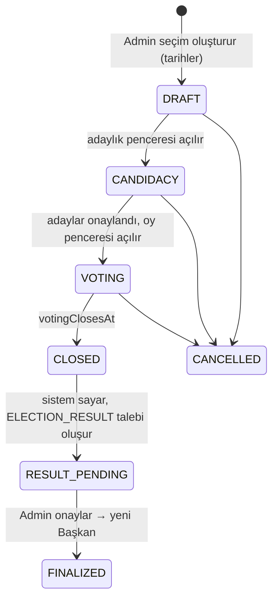

# Online Başkanlık Seçimi

## 1. Akış

Durum geçişleri zamanla (cron, 5 dk'da bir) veya Admin düğmesiyle.

## 2. Kurallar
- **Seçmen:** seçimin oy penceresi açıldığı anda kulübün `ACTIVE` üyesi olan, `type=STUDENT`, hesabı `ACTIVE` kullanıcılar. Liste `eligibleSnapshotAt` anında dondurulur (sonradan katılan oy veremez → üye şişirme engellenir). *(Varsayım: mezun oy vermez.)*
- **Aday:** seçmen kriterlerini sağlayan, başka bir kulübün başkanı olmayan üye. Adaylık metni (TR, ≤ 2000 karakter). Admin adayları onaylar.
- **Oy:** kişi başı 1 oy, değiştirilemez. Tek aday varsa "Evet / Hayır" oylaması.
- **Gizlilik:** `BallotReceipt(electionId, userId)` ve `Vote(electionId, candidateId)` aynı transaction'da, aralarında bağlantı yok, `Vote.id` rastgele UUID, zaman damgası yok. Ara sonuçlar oy kapanana kadar **kimseye** gösterilmez (Admin dahil); yalnızca katılım oranı görünür.
- **Sonuç:** en çok oy; eşitlikte Admin kura çeker veya ikinci tur açar. Minimum katılım şartı yok (ayar olarak eklenebilir).
- **Uygulama:** `ELECTION_RESULT` onaylanınca `Club.presidentId` değişir; eski Başkanın görevli ekibi için Admin "koru / sıfırla" seçer; tarafların hepsine bildirim + mail.
- **Admin'in doğrudan atama yetkisi** korunur (seçim dışında acil durumlar için), AuditLog'a yazılır.

## 3. Ekranlar
- Admin: seçim oluştur (kulüp, başlık, 4 tarih), aday onay listesi, katılım oranı, sonuç onayı.
- Üye: kulüp sayfasında seçim bandı → aday ol / adayları gör / oy ver (onay modalı: "Oyunuz değiştirilemez").
- Sonuç sayfası: aday başına oy sayısı ve yüzdesi (FINALIZED sonrası).
