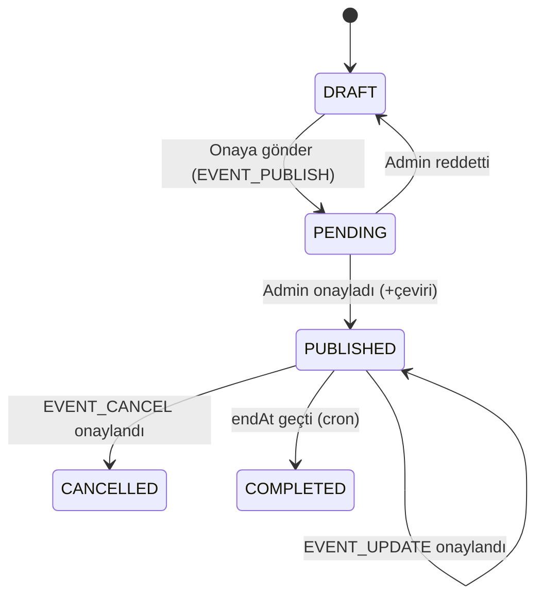

# Etkinlik, Başvuru Formu, Takım ve Çok Dillilik

## 1. Kategoriler (seed — tüm kulüp türleri)
**Kulüp kategorileri:** Spor · E-spor · Kültür-Sanat · Müzik · Tiyatro-Sinema · Bilim-Teknoloji · Mühendislik · Girişimcilik-Kariyer · Sosyal Sorumluluk · Doğa-Outdoor · Dil-Kültür · Akademik · Medya-Yayın · Diğer.

**Etkinlik üst kategorileri → alt kategoriler (örnek):**
| Üst | Alt |
|---|---|
| Turnuva / Yarışma | Futbol, Basketbol, Voleybol, Masa tenisi, Satranç, E-spor, Bilgi yarışması, Hackathon, Diğer |
| Atölye / Eğitim | Workshop, Bootcamp, Kurs |
| Konferans / Söyleşi | Panel, Söyleşi, Seminer |
| Sosyal | Buluşma, Gezi, Kamp, Parti |
| Sanat / Gösteri | Konser, Tiyatro, Sergi, Gösterim |
| Sosyal Sorumluluk | Gönüllülük, Bağış kampanyası |
| Kariyer | Kariyer günü, Mülakat simülasyonu |
| Diğer | — |
Kategoriler Süper Admin tarafından yönetilebilir (F4+).

## 2. Etkinlik yaşam döngüsü

Türetilmiş başvuru durumu (alan değil, hesaplanır): `NOT_OPEN` (applyOpensAt'tan önce) · `OPEN` · `CLOSING_SOON` (≤ 48 saat) · `FULL` (kontenjan dolu, yedek liste kapalı) · `WAITLIST` (kontenjan dolu, yedek açık) · `CLOSED`.

## 3. Etkinlik oluşturma sihirbazı (kulüp paneli)
1. **Temel:** üst/alt kategori, başlık, kısa özet (280), kapak görseli (16:9, kırpma), galeri (≤ 8 görsel).
2. **Açıklama:** Tiptap editörü — H1, H2, H3, kalın, italik, altı çizili, madde/numara listesi, alıntı, bağlantı, görsel ekleme, yatay çizgi. Yapıştırılan HTML temizlenir.
3. **Zaman ve yer:** başlangıç/bitiş, başvuru açılış/kapanış (deadline), yer adı + adres + harita linki veya online link.
4. **Katılım:** bireysel/takım (min-max kişi), kontenjan (kişi veya takım), yedek liste, otomatik kabul / elle onay, uygunluk (tüm üyeler / sadece öğrenci / sadece mezun).
5. **Başvuru formu:** form oluşturucu (§4).
6. **Önizleme → Onaya gönder.**
Taslak otomatik kaydedilir (debounce 2 sn, server action).

## 4. Form oluşturucu
**Otomatik eklenen (düzenlenemez, profilden):** ad soyad, mail, öğrenci no, fakülte/bölüm, sınıf/mezuniyet yılı, telefon. Yönetici bunlardan hangilerinin export'ta görüneceğini seçer. Cinsiyet ve doğum tarihi yalnızca yönetici "gerekli" işaretlerse (ör. kategori ayrımı, yaş sınırı) gösterilir/aktarılır — KVKK veri minimizasyonu.

**Alan tipleri:**
| Tip | Ayarlar |
|---|---|
| Kısa metin | maks uzunluk, desen (mail/telefon/URL) |
| Uzun metin | maks uzunluk |
| Tek seçim (radio) | seçenekler, "Diğer" serbest metin |
| Çoklu seçim | seçenekler, min/max seçim |
| Açılır liste | seçenekler |
| Sayı | min/max, tamsayı |
| Tarih | min/max |
| Evet/Hayır | — |
| Dosya | uzantılar, maks MB (≤ 10) |
| Onay kutusu | metin (ör. sağlık beyanı, feragatname, KVKK) — işaretlenmesi zorunlu |
| Bölüm başlığı | sadece görsel ayırıcı + açıklama |
Her alan: etiket TR (EN otomatik çevrilir, elle düzeltilebilir), açıklama, zorunlu, sıra (yukarı/aşağı düğmeleri), koşul ("X alanı = Y ise göster"), takım modunda "takım başına bir kez" (`teamLevel`).
**Hazır şablonlar:** Spor turnuvası (pozisyon, forma bedeni, sağlık beyanı), Workshop (deneyim seviyesi, beklenti), Gezi (acil durum kişisi, diyet), Hackathon (GitHub, rol). Şablon = önceden doldurulmuş alan listesi.
Etkinlikte başvuru varken alan silinemez (yalnızca gizlenir) → veri kaybı olmaz.

## 5. Başvuru akışı
1. Üye değilse: "Önce kulübe katıl" (davet kodu/link gerekir; kulüp sayfasında "katılım kodu gir").
2. Uygunluk + zaman penceresi + kontenjan kontrolü (transaction + satır kilidi `SELECT ... FOR UPDATE` etkinlik satırında → yarış durumu yok).
3. Form doldurulur → `Registration` (`APPLIED`; `autoAccept` ise kontenjan varsa `ACCEPTED`, yoksa `WAITLISTED`).
4. Kullanıcı deadline'a kadar cevaplarını düzenleyebilir ve iptal edebilir. İptalde `autoPromoteWaitlist` → sıradaki kabul + mail.
5. Yönetici ekranı: tablo (arama, durum filtresi, sütun seçimi), toplu kabul/ret, yedek sıralama, **Excel (xlsx) / CSV indir** (profil alanları + cevaplar + takım adı + durum).

## 6. Takım kaydı
1. Kaptan "Takım kur" → takım adı + takım seviyesindeki form alanları → `Team` + 6 karakterlik takım kodu (karışmayan alfabe).
2. Kaptan kodu/linki paylaşır; üye (kulüp üyesi olmalı) kodu girer → kendi bireysel alanlarını doldurur → `TeamMember` + `Registration(teamId)`.
3. Bir kişi bir etkinlikte tek takımda. Kaptan üye çıkarabilir, kaptanlığı devredebilir, takımı dağıtabilir (deadline'a kadar).
4. Takım `teamMinSize`'a ulaşınca "Başvuruyu tamamla" aktif olur → takım `APPLIED`/`ACCEPTED` (kontenjan takım sayısıdır).
5. Max boyut dolunca kod kabul etmez. Deadline'da min boyutun altındaki takımlar uyarılır, otomatik reddedilmez (yönetici karar verir).
6. Kabul edilmiş takımlar → tek tıkla turnuvaya katılımcı olarak aktarılır ([TOURNAMENTS.md](TOURNAMENTS.md)).

## 7. Çok dillilik (i18n)
### 7.1 Arayüz metinleri
- `next-intl`, `messages/tr.json` ve `messages/en.json`; varsayılan `tr`.
- Dil seçimi: header'daki TR/EN düğmesi → `NEXT_LOCALE` cookie + giriş yapmışsa `User.locale`. URL prefix yok (daha basit rota yapısı).
- Mailler kullanıcının `locale`'inde.

### 7.2 Kullanıcı içeriği (otomatik çeviri)
- Kaynak dil **her zaman TR**. Çevrilen alanlar: kulüp kısa açıklama + açıklama, etkinlik başlığı + özet + açıklama, form alanı etiketleri/açıklamaları/seçenekleri, duyurular.
- **Ne zaman:** Admin onayı anında (`EVENT_PUBLISH`, `EVENT_UPDATE`, `CLUB_UPDATE` handler'ları), duyuruda yayınlanınca. Taslaklar çevrilmez → ücretsiz kota boşa harcanmaz.
- **Nasıl:** Tiptap JSON → HTML (`@tiptap/html`) → DeepL (`tag_handling=html`, `source_lang=TR`, `target_lang=EN-US`) → HTML → Tiptap JSON (`generateJSON`) → `descriptionEn`. Başlık/özet/etiketler tek istekte toplu (`text[]` dizisi) gönderilir.
- **Tekrar çevirme engeli:** `translationHash = sha256(kaynak alanlar)`; hash değişmediyse API çağrılmaz.
- **Elle düzeltme:** Başkan EN metni düzenleyebilir → `xxxEnManual=true` sayılır (hash eşitse üzerine yazılmaz).
- **Hata/kota:** DeepL hatasında yayın yine yapılır, EN alanı boş kalır → arayüz TR gösterir + küçük "Translation pending" etiketi; günlük cron başarısızları tekrar dener.
- **Gösterim:** `pick(locale, tr, en)` yardımcı fonksiyonu: locale=en ve en varsa en, yoksa tr.
- **Kota tahmini:** ortalama etkinlik ≈ 3.000 karakter → ayda ~150 etkinlik/güncelleme 500K ücretsiz kotaya sığar. Aşılırsa DeepL Pro (karakter başı ücret) veya Claude Haiku sağlayıcısı (`TranslationProvider` arayüzü sayesinde tek dosya).

```ts
interface TranslationProvider {
  translate(input: { texts: string[]; html?: boolean; source: 'tr'; target: 'en' }): Promise<string[]>
}
// TRANSLATION_PROVIDER = deepl | none
```

## 8. Feed ve Keşfet
- **Ana sayfa (giriş yapmış):** "Kulüplerimin etkinlikleri" — sıralama: başvurusu açık ve deadline'ı yakın olanlar → yaklaşan etkinlikler → başvurduklarım ayrı sekme. Üstte kısa şerit: "Deadline yaklaşıyor (3)". Boşsa: Keşfet'e yönlendiren boş durum.
- **Etkinlik kartı:** kapak (16:9 WebP 400w), kulüp logosu + adı, kategori çipi, başlık, tarih-saat (gün adıyla), konum, kontenjan çubuğu (12/32), başvuru rozeti (Açık / Son 2 gün / Doldu-Yedek / Kapandı), deadline geri sayımı ("2 gün 4 saat"), kullanıcının durumu (Başvurdun / Kabul / Yedek #3), bireysel/takım ikonu.
- **Keşfet:** üniversitenin tüm aktif kulüpleri (kategori filtresi, arama) + yayındaki tüm etkinlikler (kategori, tarih aralığı, "başvurusu açık" filtresi). Üye olmayan etkinlik kartında "Kulübe katıl" çağrısı.
- **Arama:** Postgres `ILIKE` + `pg_trgm` indeksi (başlık, kulüp adı). Tam metin arama motoru yok.
